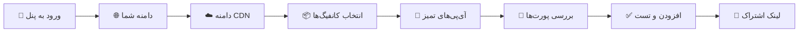

<div align="center">


<a href="https://github.com/AyhanMansur/AyhanX-Direct">
  
</a>

<br/>

[](https://linux.org)
[](https://www.python.org)
[](https://github.com/XTLS/Xray-core)
[](https://github.com/AyhanMansur/AyhanX-Direct/blob/main/LICENSE)
[](https://github.com/AyhanMansur/AyhanX-Direct/)
[](https://github.com/AyhanMansur/AyhanX-Direct/)

</div>

---

## 🌟 درباره پروژه

**AyhanX-Direct** با یک اسکریپت، مجموعه‌ای از کانفیگ‌های مقاوم در برابر سانسور را به **پنل موجود شما** اضافه می‌کند. پنل‌های **3x-ui**، **Pasarguard** و **Marzban** پشتیبانی می‌شوند.

> 🔒 **هیچ چیزی حذف یا ویرایش نمی‌شود.** هیچ inbound، کلاینت یا هاستی که از قبل وجود داشته دست نمی‌خورد.

این پروژه فورکی از [pdnczone/3x-ui-pro-configs](https://github.com/pdnczone/3x-ui-pro-configs) است که قابلیت‌های جدیدی دارد:

| | قابلیت‌های جدید در AyhanX-Direct |
|---|---|
| 🧩 | **چند پنل**: 3x-ui، Pasarguard، Marzban |
| 🗄️ | **تشخیص خودکار 3x-ui** از پایگاه داده |
| 🔎 | **اسکنر** برای رنج IP و لیست دامنه |
| 🩺 | **بررسی سلامت** با ری‌استارت خودکار Xray |
| 🗑️ | **حذف کلاینت** و کانفیگ‌های ساخته‌شده توسط اسکریپت |

---

## ⚡ شروع سریع

روی سرور با دسترسی **root** اجرا کنید:

```bash
bash <(curl -Ls https://raw.githubusercontent.com/AyhanMansur/AyhanX-Direct/main/install.sh)
```



<details>
<summary><b>📋 اسکریپت چه چیزهایی می‌پرسد</b></summary>

<br/>

1. **کاری که می‌خواهید انجام دهید**: نصب کانفیگ، فقط اسکنر، یا هر دو.
2. **پنل**: 3x-ui، Pasarguard، Marzban، یا تشخیص خودکار.
3. **ورود به پنل**: توکن API (از Settings › API Tokens) یا نام کاربری و رمز.
4. **دامنه شما**: باید مستقیم به سرور اشاره کند (ابر خاکستری Cloudflare). اگر گواهی ندارید، می‌تواند با Let's Encrypt صادر کند.
5. **دامنه CDN** (اختیاری): پشت Cloudflare با ابر نارنجی و حالت SSL/TLS روی **Full**.
6. **کانفیگ‌ها**: شماره‌ها با کاما، یا `all`.
7. **تعداد آی‌پی‌های تمیز**: پیش‌فرض `20`، حداکثر `30`.

</details>

---

## 📦 کانفیگ‌ها

| کلید | کانفیگ | پروتکل | نیاز |
|:-:|---|---|---|
| `tws` | 👾 Trojan • WS | Trojan روی WebSocket | گواهی TLS |
| `twst` | 👾 Trojan • WS • TLS | Trojan روی WebSocket با TLS | گواهی TLS |
| `twsp` | 🧬 Trojan • WS • PQ | Trojan روی WebSocket با Sudoku | Xray 26 |
| `twstp` | 🧬 Trojan • WS • TLS • PQ | همان بالا با TLS | گواهی + Xray 26 |
| `thu` | 👾 Trojan • HU • Plain | Trojan روی HTTPUpgrade | — |
| `tch` | 👾 Trojan • HU • CDN | Trojan روی HTTPUpgrade از طریق Cloudflare | دامنه CDN |
| `tcht` | 👾 Trojan • HU • CDN • TLS | همان بالا با TLS | گواهی + دامنه CDN |
| `trxp` | 👾 Trojan • REALITY • XHTTP | Trojan با REALITY | — |
| `trgp` | 👾 Trojan • REALITY • gRPC | Trojan با REALITY | — |
| `rvpq` | 🧬 Reality • Vision • PQ | VLESS + REALITY (TCP) با کلید پسا‌کوانتومی | Xray 26 |
| `rxpq` | 🧬 Reality • XHTTP • PQ | VLESS + REALITY (XHTTP) با کلید پسا‌کوانتومی | Xray 26 |
| `rgpq` | 🧬 Reality • gRPC • PQ | VLESS + REALITY (gRPC) با کلید پسا‌کوانتومی | Xray 26 |

> ⚠️ کانفیگ‌های REALITY + PQ (`rvpq`، `rxpq`، `rgpq`) هنوز روی پنل زنده تأیید نشده‌اند.

<details>
<summary><b>🧩 پنل‌های پشتیبانی‌شده</b></summary>

<br/>

| پنل | روش ورود | وضعیت |
|---|---|---|
| **3x-ui 3.x** | توکن API یا نام کاربری/رمز | ✅ پشتیبانی کامل |
| **Pasarguard** | نام کاربری/رمز ادمین | ✅ همه کانفیگ‌ها |
| **Marzban** | نام کاربری/رمز ادمین | ⚠️ بدون کانفیگ‌های PQ و REALITY؛ روی پنل زنده کامل تست نشده |

</details>

---

## 🔧 پیش‌نیازها

- Ubuntu یا Debian (یا هر توزیعی با `apt`، `dnf`، `yum`، `apk` یا `pacman`)
- `python3`، `curl`، `openssl`، `iproute2`
- برای کانفیگ‌های PQ و REALITY: **Xray-core 26.x**
- پورت‌هایی که در پایان نصب نمایش داده می‌شوند را در فایروال ابری باز کنید (TCP، و UDP برای Hysteria)

---

## ⚙️ تداخل پورت‌ها

دو inbound نمی‌توانند یک پورت را به اشتراک بگذارند. اسکریپت قبل از افزودن هر کانفیگ، inboundهای پنل و برنامه‌های در حال اجرا را بررسی می‌کند و صاحب پورت اشغال‌شده را نشان می‌دهد:

| کلید | عملکرد |
|:-:|---|
| `Enter` | پورت آزاد بعدی را انتخاب می‌کند *(پیشنهادی)* |
| `123` | پورت دلخواه شما (اگر اشغال باشد رد می‌شود) |
| `o` | **Origin Rule** (فقط CDN): کلاینت از 443 استفاده می‌کند و Cloudflare به پورت آزاد فوروارد می‌کند |
| `s` | این کانفیگ را رد کن؛ inbound شما دست‌نخورده می‌ماند |

<details>
<summary><b>📌 نکات</b></summary>

<br/>

- **CDN**: Cloudflare فقط پورت‌های `443 2053 2083 2087 2096 8443` را پروکسی می‌کند. اگر همه اشغال باشند، از `o` استفاده کنید. اسکریپت قانونی را که باید در *Rules › Origin Rules* بسازید چاپ می‌کند.
- **REALITY روی 443**: اگر 443 اشغال باشد، کانفیگ پورت دیگری می‌گیرد.
- **حالت خودکار**: `--ports auto` (یا `--yes`) همیشه پورت آزاد بعدی را می‌گیرد. کانفیگ CDN بدون پورت آزاد Cloudflare رد می‌شود.

</details>

---

## 🔎 اسکنر

از منو گزینه **۲** را انتخاب کنید، یا `--scan` بدهید:

- اسکن **IPv4** یا **IPv6** روی رنج‌ها، یا اسکن **لیست دامنه**
- محدودیت تعداد با `--scan-limit`
- ساخت لینک از روی یک قالب **vless، vmess، trojan، ss یا hysteria** برای هر آی‌پی فعال
- خروجی آی‌پی‌های تمیز در `clean-ips.txt`

## 🧊 آی‌پی‌های تمیز

اگر دامنه CDN داشته باشید، آی‌پی‌های فعال از طریق Cloudflare با همان دامنه تست می‌شوند و فقط آدرس‌هایی با پاسخ زیر ۱۵۰۰ میلی‌ثانیه نگه داشته می‌شوند. اگر `clean-ips.txt` محلی وجود داشته باشد از همان استفاده می‌شود، وگرنه از مخزن دانلود می‌شود.

> ⚠️ نتایج بسته به شبکه (موبایل، خانگی یا دیتاسنتر) متفاوت است. اگر آی‌پی‌ای پیدا کردید که خوب کار می‌کند، Pull Request بفرستید!

---

## 🛡 امنیت

- 💾 **پشتیبان قبل از تغییر**:
  - 3x-ui: `/etc/x-ui/x-ui.db.bak-pro-*`
  - Marzban و Pasarguard: فایل JSON از کانفیگ هسته در پوشه فعلی
- 🔁 **یکی‌یکی**: هر inbound جداگانه اضافه و بررسی می‌شود. اگر Xray آن را رد کند، فقط همان برگشت داده می‌شود.
- 🧰 **تغییرات سراسری فقط با تأیید شما**: `remarkTemplate` روی `{{HOST}}`، فعال‌سازی اشتراک JSON، و BBR.

---

## ⚠️ محدودیت‌ها

- Marzban روی پنل زنده کامل تست نشده است.
- کانفیگ‌های REALITY + PQ هنوز روی پنل زنده تأیید نشده‌اند.
- حذف کلاینت در 3x-ui از `/panel/api/clients/del/` استفاده می‌کند که در همه نسخه‌ها تأیید نشده است.
- اگر Marzban لینک اشتراک نسبی بدهد، آدرس از دامنه یا IP سرور ساخته می‌شود؛ ممکن است لازم باشد `XRAY_SUBSCRIPTION_URL_PREFIX` را در `.env` پنل تنظیم کنید.
- Cloudflare فقط پورت‌های `443 2053 2083 2087 2096 8443` را پروکسی می‌کند.

---

## 🔗 **لینک‌های مفید**

| منبع | آدرس |
|---|---|
| مخزن این پروژه | [AyhanMansur/AyhanX-Direct](https://github.com/AyhanMansur/AyhanX-Direct) |
| مخزن پروژه اصلی | [pdnczone/3x-ui-pro-configs](https://github.com/pdnczone/3x-ui-pro-configs) |
| پنل 3x-ui | [MHSanaei/3x-ui](https://github.com/MHSanaei/3x-ui) |

---

## 🤝 **مشارکت!**

* یک **Issue** باز کنید
* یک **Pull Request** بفرستید
* یا یک **Star** ⭐ بدهید تا دیگران هم پیدا کنند!

---

## 📜 **مجوز**

این پروژه تحت مجوز **MIT** منتشر شده است: آزاد برای استفاده، تغییر و توزیع.

---

<p align="center">
  <b>ساخته‌شده با ❤️ توسط Ayhan Mansur</b>
</p>
