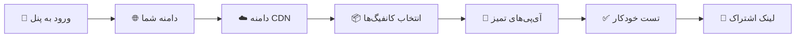

<div align="center">


<a href="https://github.com/AyhanMansur/AyhanX-Direct">
  
</a>

<br/>

[](https://linux.org)
[](https://python.org)
[](https://python.org)
[](https://github.com/AyhanMansur/AyhanX-Direct/)
[](https://github.com/AyhanMansur/AyhanX-Direct/)
[](https://github.com/AyhanMansur/AyhanX-Direct/)

</div>

---

## 🌟 درباره پروژه

**AyhanX-Direct** با یک دستور، یک بسته کامل و حرفه‌ای از کانفیگ‌های مقاوم در برابر سانسور را به **پنل موجود شما** اضافه می‌کند.

> 🔒 **هیچ چیزی حذف یا ویرایش نمی‌شود.** هیچ inbound، کلاینت یا هاستی دست نمی‌خورد.

این پروژه فورکی از [pdnczone/3x-ui-pro-configs](https://github.com/pdnczone/3x-ui-pro-configs) است که قابلیت‌های جدیدی دارد:

| | قابلیت‌های جدید در AyhanX-Direct |
|---|---|
| 🔎 | **اسکنر**: [توضیح دهید: آی‌پی تمیز / پورت / SNI] |
| 🧩 | **پشتیبانی از چند پنل**: [3x-ui، Marzban، ...] |
---

## ⚡ نصب سریع

روی سرور به‌صورت **root** اجرا کنید:

```bash
bash <(curl -Ls https://raw.githubusercontent.com/AyhanMansur/AyhanX-Direct/main/install.sh)
```



<details>
<summary><b>📋 اسکریپت چه چیزهایی می‌پرسد</b></summary>

<br/>

1. **ورود به پنل**: توکن API (از Settings › API Tokens) یا نام کاربری و رمز عبور.
2. **دامنه شما**: مستقیماً به سرور اشاره می‌کند (ابر خاکستری Cloudflare). اگر گواهی ندارید، می‌تواند گواهی Let's Encrypt صادر کند.
3. **دامنه CDN**: زیردامنه‌ای پشت Cloudflare (ابر نارنجی)، حالت SSL/TLS روی **Full**.
4. **کانفیگ‌ها**: از منو انتخاب کنید (شماره‌ها با کاما جدا شده، یا `all`).
5. **تعداد آی‌پی تمیز Cloudflare**: پیش‌فرض `20`.

</details>

---

## 📦 کانفیگ‌ها

| | کانفیگ | توضیح |
|:-:|---|---|
| ⚡ | **Reality Vision** | کانفیگ اصلی، سریع‌ترین و مخفی‌ترین |
| 🌀 | **Reality XHTTP** | REALITY روی XHTTP با padding |
| 🔷 | **Reality gRPC** | REALITY روی gRPC |
| 🔐 | **TLS Vision** | گواهی واقعی، به‌همراه 🧩 Fragment و 6️⃣ نسخه‌های IPv6 |
| 🛰 | **TLS XHTTP** | مستقیم و از طریق CDN |
| 🌐 | **CDN WS** | از طریق Cloudflare، به‌همراه 🧊 آی‌پی‌های تمیز |
| 🔗 | **CDN HTTPUpgrade** | از طریق Cloudflare |
| 🚄 | **Hysteria2** | UDP/QUIC با FinalMask Salamander |
| 🧬 | **PQ Sudoku** | VLESS پسا‌کوانتومی با FinalMask Sudoku *(آزمایشی)* |
| 🛟 | **Shadowsocks-2022** | پشتیبان |

### 🎭 FinalMask

| ماسک | کجا | چه کار می‌کند |
|---|---|---|
| **Fragment** | کانفیگ‌های TLS و CDN (سمت کلاینت) | ClientHello را به قطعات تقسیم می‌کند |
| **Salamander** | Hysteria2 | ترافیک QUIC را مبهم می‌کند |
| **Sudoku** | PQ | دست‌دادن پسا‌کوانتومی را پنهان می‌کند |

همه کانفیگ‌ها زیر **یک کلاینت جدید** با **یک لینک اشتراک** قرار می‌گیرند. اگر IPv6 سرور کار کند، نسخه IPv6 هم ساخته می‌شود.

> 💡 برای کانفیگ‌های FinalMask از **اشتراک JSON** با کلاینت **Xray-core 26** (v2rayNG یا v2rayN جدید) استفاده کنید. Hysteria2 + Salamander در Hiddify و NekoBox هم کار می‌کند.

---

```bash
```

| گزینه | توضیح |
|---|---|
| `[گزینه]` | [توضیح] |

---

## 🧩 پنل‌های پشتیبانی‌شده

| پنل | نسخه | وضعیت |
|---|---|---|
| **3x-ui** | 3.x (Clients و Hosts) | ✅ پشتیبانی می‌شود |
| [پنل ۲] | [نسخه] | [وضعیت] |
| [پنل ۳] | [نسخه] | [وضعیت] |

### پیش‌نیازها

- Ubuntu یا Debian با `python3`، `curl`، `openssl`
- **Xray-core 26.x** (اگر نباشد، FinalMask، Hysteria2 و PQ به‌طور خودکار رد می‌شوند)
- پورت‌هایی که در پایان نصب نمایش داده می‌شوند را در فایروال ابری خود باز کنید (IPv4 + IPv6، و UDP برای Hysteria2)

---

## ⚙️ تداخل پورت‌ها

دو inbound هرگز نمی‌توانند یک پورت را به اشتراک بگذارند. اسکریپت ابتدا هر inbound پنل و هر برنامه روی سرور را بررسی می‌کند. اگر پورتی اشغال باشد، به شما می‌گوید چه کسی از آن استفاده می‌کند:

| کلید | عملکرد |
|:-:|---|
| `Enter` | پورت آزاد بعدی را انتخاب می‌کند *(پیشنهادی)* |
| `123` | پورت دلخواه شما (اگر اشغال باشد رد می‌شود) |
| `o` | **حالت Origin Rule** (فقط CDN): کلاینت از 443 استفاده می‌کند، Cloudflare به هر پورت آزادی فوروارد می‌کند |
| `s` | این کانفیگ را رد کن، inbound شما همان‌طور که هست می‌ماند |

<details>
<summary><b>📌 نکات</b></summary>

<br/>

- **CDN**: Cloudflare فقط پورت‌های `443 2053 2083 2087 2096 8443` را پروکسی می‌کند. اگر همه اشغال باشند، از `o` استفاده کنید. اسکریپت قانون دقیقی را که باید در *Rules › Origin Rules* اضافه کنید چاپ می‌کند:
  `Hostname = cdn… AND URI Path starts with /…  →  Destination port = …`
- **REALITY روی 443**: اگر 443 استفاده شده باشد، کانفیگ جدید پورت دیگری می‌گیرد. برای استفاده از 443، inbound قدیمی را در پنل جابه‌جا کنید و اسکریپت را دوباره اجرا کنید.
- **حالت خودکار**: `--ports auto` (یا `--yes`) همیشه پورت آزاد بعدی را می‌گیرد. کانفیگ CDN بدون پورت آزاد Cloudflare رد می‌شود.

</details>

---

## 🛡 امنیت

- 💾 **اول پشتیبان‌گیری**: `/etc/x-ui/x-ui.db.bak-pro-*`
- 🔁 **یکی‌یکی**: هر inbound بلافاصله اضافه و تأیید می‌شود. اگر Xray آن را رد کند، فقط همان inbound برگشت داده می‌شود.
- 🧰 **حداقل تغییرات سراسری**، هر دو فقط افزودنی:
  - فعال‌سازی اشتراک JSON
  - تنظیم `remarkTemplate` روی `{{HOST}}` (اول از شما پرسیده می‌شود)

---

## 🤖 حالت غیرتعاملی

```bash
bash <(curl -Ls https://raw.githubusercontent.com/AyhanMansur/AyhanX-Direct/main/install.sh) \
  --yes --token <API_TOKEN> --domain my.example.com --cdn cdn.example.com --configs all --clean 20
```

| گزینه | توضیح |
|---|---|
| `--configs` | `all` یا لیست: `rv,rx,rg,tv,tx,ws,hu,hy,pq,ss` |
| `--clean N` | تعداد کانفیگ‌های آی‌پی تمیز Cloudflare (۰–۳۰) |
| `--ports auto\|ask` | رفتار در تداخل پورت |
| `--email E` | نام کلاینت جدید |
| `--dry-run` | نمایش برنامه، بدون هیچ تغییری |
| `--no-bbr`، `--no-test` | رد کردن BBR / رد کردن تست اتصال |
| `[--panel X]` | [نوع پنل، اگر اضافه کرده‌اید] |
| `[--scan]` | [اجرای اسکنر، اگر اضافه کرده‌اید] |

---

## 🧊 آی‌پی‌های تمیز

لیست در فایل `clean-ips.txt` قرار دارد. هر بار اجرا آن را دانلود می‌کند، هر آدرس را از طریق Cloudflare با **دامنه CDN شما** تست می‌کند و فقط سالم‌ها را نگه می‌دارد.

> ⚠️ این آدرس‌ها از ۵ نود تست در ایران (دیتاسنترهای تهران) در دسترس بودند. اتصالات موبایل یا خانگی ممکن است متفاوت باشد. آی‌پی‌هایی پیدا کردید که برایتان کار می‌کند؟ Pull Request بفرستید!

## 🔗 **لینک‌های مفید**

| منبع | آدرس |
| --- | --- |
| مخزن پروژه | [AyhanMansur/Xui-Panel](https://github.com/AyhanMansur/AyhanX-Direct) |
| مخزن پروژه اصلی | [pdnczone/3x-ui-pro-config](https://github.com/pdnczone/3x-ui-pro-configs) |
| پنل اصلی 3X-UI | [MHSanaei/3x-ui](https://github.com/mhsanaei/3x-ui) |

---

## 🤝 **مشارکت!**

اگر ایده‌ای برای بهبود دارید، خوشحال می‌شویم:

* یک **Issue** باز کنید
* یک **Pull Request** بفرستید
* یا حتی یک **Star** ⭐ بدهید تا دیگران هم آن را پیدا کنند!

---

## 📜 **مجوز**

این پروژه تحت مجوز **MIT** منتشر شده است — آزاد برای استفاده، تغییر و توزیع.

---

<p align="center">
  <b>ساخته‌شده با ❤️ توسط Ayhan Mansur</b>
</p>
