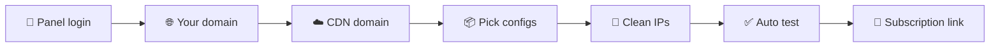

<div align="center">


<a href="https://github.com/AyhanMansur/AyhanX-Direct">
  
</a>

<br/>


</div>

---

## 🌟 About

**AyhanX-Direct** adds a complete, professional, censorship-resistant config pack to your **existing** panel in one command.

> 🔒 **Nothing is deleted or edited.** No existing inbound, client, or host is touched.

This project is a fork of [pdnczone/3x-ui-pro-configs](https://github.com/pdnczone/3x-ui-pro-configs) with new features:

| | New in AyhanX-Direct |
|---|---|
| 🔎 | **Scanner**: [describe: clean IPs / ports / SNI] |
| 🧩 | **Multi-panel support**: [3x-ui, Marzban, ...] |
| ✨ | [Anything else you added] |

---

## ⚡ Quick Install

Run on your server as **root**:

```bash
bash <(curl -Ls https://raw.githubusercontent.com/AyhanMansur/AyhanX-Direct/main/install.sh)
```



<details>
<summary><b>📋 What the script asks you</b></summary>

<br/>

1. **Panel login**: API token (Settings › API Tokens) or username and password.
2. **Your domain**: points directly to the server (Cloudflare grey cloud). Can issue a Let's Encrypt certificate if you have none.
3. **CDN domain**: subdomain behind Cloudflare (orange cloud), SSL/TLS mode **Full**.
4. **Configs**: choose from a menu (comma-separated numbers, or `all`).
5. **Clean Cloudflare IP count**: default `20`.

</details>

---

## 📦 Configs

| | Config | Description |
|:-:|---|---|
| ⚡ | **Reality Vision** | Main config, fastest and stealthiest |
| 🌀 | **Reality XHTTP** | REALITY over XHTTP with padding |
| 🔷 | **Reality gRPC** | REALITY over gRPC |
| 🔐 | **TLS Vision** | Real certificate, plus 🧩 Fragment and 6️⃣ IPv6 variants |
| 🛰 | **TLS XHTTP** | Direct and via CDN |
| 🌐 | **CDN WS** | Through Cloudflare, plus 🧊 clean IPs |
| 🔗 | **CDN HTTPUpgrade** | Through Cloudflare |
| 🚄 | **Hysteria2** | UDP/QUIC with FinalMask Salamander |
| 🧬 | **PQ Sudoku** | Post-quantum VLESS with FinalMask Sudoku *(experimental)* |
| 🛟 | **Shadowsocks-2022** | Backup |

### 🎭 FinalMask

| Mask | Where | What it does |
|---|---|---|
| **Fragment** | TLS and CDN configs (client-side) | Splits the ClientHello into pieces |
| **Salamander** | Hysteria2 | Obfuscates QUIC traffic |
| **Sudoku** | PQ | Masks the post-quantum handshake |

All configs live under **one new client** with **one subscription link**. If the server's IPv6 works, an IPv6 version is created too.

> 💡 For FinalMask configs, use the **JSON subscription** with an **Xray-core 26** client (recent v2rayNG or v2rayN). Hysteria2 + Salamander also works in Hiddify and NekoBox.

---

## 🔎 Scanner

[Describe your scanner here.]

```bash
[command to run the scanner]
```

| Option | Description |
|---|---|
| `[option]` | [description] |

---

## 🧩 Supported Panels

| Panel | Version | Status |
|---|---|---|
| **3x-ui** | 3.x (Clients and Hosts) | ✅ Supported |
| [Panel 2] | [version] | [status] |
| [Panel 3] | [version] | [status] |

### Requirements

- Ubuntu or Debian with `python3`, `curl`, `openssl`
- **Xray-core 26.x** (FinalMask, Hysteria2, PQ are skipped automatically if missing)
- Open the ports shown at the end of install in your cloud firewall (IPv4 + IPv6, and UDP for Hysteria2)

---

## ⚙️ Port Conflicts

Two inbounds can never share a port. The script checks every panel inbound and every program on the server first. If a port is busy, it tells you who uses it:

| Key | Action |
|:-:|---|
| `Enter` | Picks the next free port *(recommended)* |
| `123` | Your own port (rejected if also busy) |
| `o` | **Origin Rule mode** (CDN only): client uses 443, Cloudflare forwards to any free port |
| `s` | Skip this config, your inbound stays as is |

<details>
<summary><b>📌 Notes</b></summary>

<br/>

- **CDN**: Cloudflare only proxies `443 2053 2083 2087 2096 8443`. If all are busy, use `o`. The script prints the exact rule to add under *Rules › Origin Rules*:
  `Hostname = cdn… AND URI Path starts with /…  →  Destination port = …`
- **REALITY on 443**: if 443 is used, the new config gets another port. To use 443, move your old inbound in the panel and run the script again.
- **Auto mode**: `--ports auto` (or `--yes`) always takes the next free port. A CDN config with no free Cloudflare port is skipped.

</details>

---

## 🛡 Safety

- 💾 **Backup first**: `/etc/x-ui/x-ui.db.bak-pro-*`
- 🔁 **One by one**: each inbound is added and verified immediately. If Xray rejects it, only that inbound is rolled back.
- 🧰 **Minimal global changes**, both additive only:
  - enabling JSON subscription
  - setting `remarkTemplate` to `{{HOST}}` (you are asked first)

---

## 🤖 Non-Interactive Mode

```bash
bash <(curl -Ls https://raw.githubusercontent.com/AyhanMansur/AyhanX-Direct/main/install.sh) \
  --yes --token <API_TOKEN> --domain my.example.com --cdn cdn.example.com --configs all --clean 20
```

| Option | Description |
|---|---|
| `--configs` | `all` or list: `rv,rx,rg,tv,tx,ws,hu,hy,pq,ss` |
| `--clean N` | Cloudflare clean-IP configs (0–30) |
| `--ports auto\|ask` | Port-conflict behavior |
| `--email E` | Name of the new client |
| `--dry-run` | Show the plan, change nothing |
| `--no-bbr`, `--no-test` | Skip BBR / skip connection test |
| `[--panel X]` | [panel type, if you added it] |
| `[--scan]` | [run scanner, if you added it] |

---

## 🧊 Clean IPs

The list lives in `clean-ips.txt`. Each run downloads it, tests every address through Cloudflare using **your** CDN domain, and keeps only the healthy ones.

> ⚠️ These addresses were reachable from 5 test nodes in Iran (Tehran data centers). Mobile or home connections may differ. Found IPs that work for you? Send a Pull Request!

---

## 🤝 Contributing

```bash
git checkout -b feature/my-feature
git commit -m "Add my feature"
git push origin feature/my-feature
```

Then open a Pull Request. All contributions are welcome. ⭐ A star helps a lot!

---

## ⚠️ Disclaimer

For lawful privacy and network-access use only. You are responsible for following your local laws and the terms of your hosting and CDN providers.

<br/>
<center>
  
  <p>Made with ❤️ by Ayhan Mansur</p>
</center>
</div>
